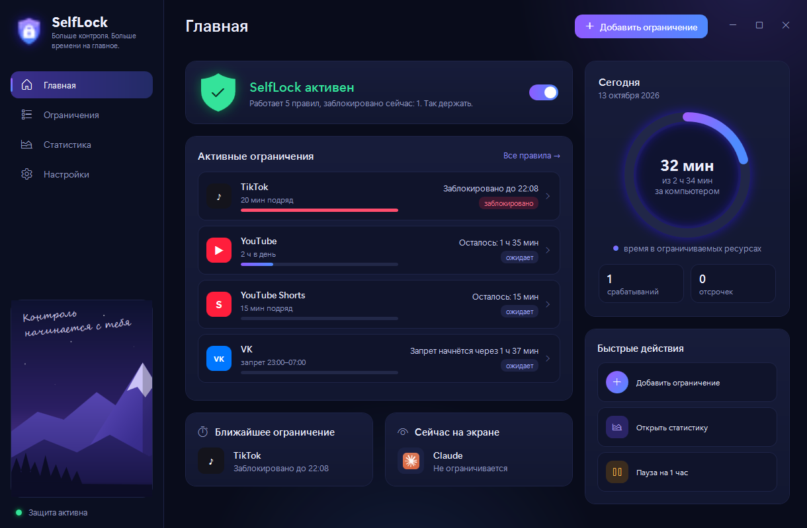
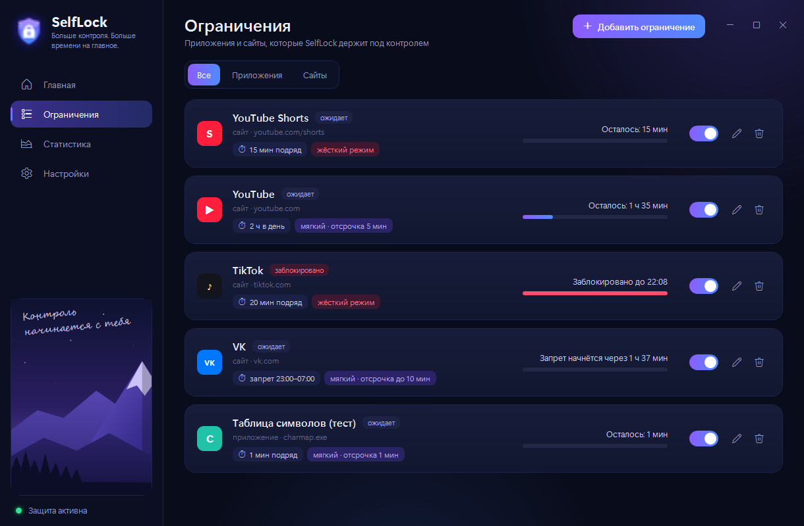
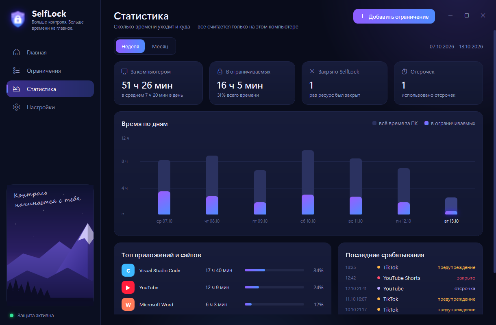
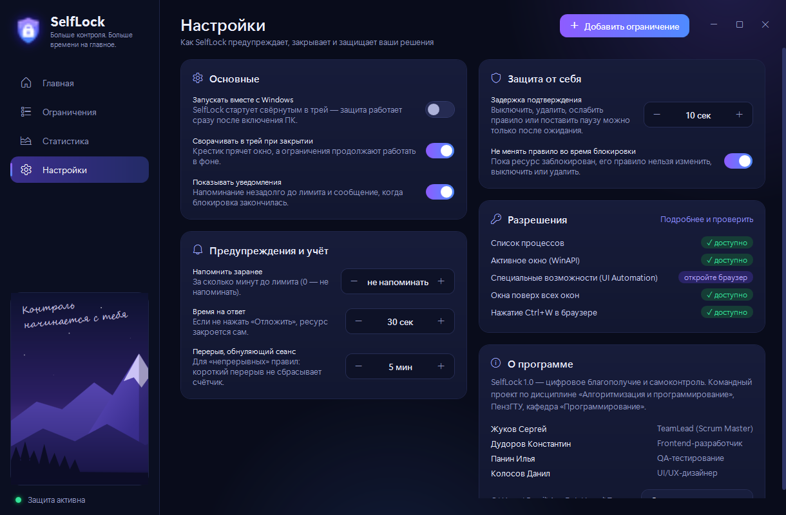

<div align="center">

# 🔒 SelfLock

### Больше контроля. Больше времени на главное.

Умный инструмент самоконтроля для Windows, который помогает учиться и работать без залипания в соцсетях, играх, YouTube Shorts и клипах.

[-2ea44f?style=for-the-badge&logo=windows&logoColor=white)](../../releases)

<br/>

<p align="center">
  
  
  
</p>

</div>

---

## Интерфейс

<div align="center">

| Главный экран | Настройка ограничений |
| :---: | :---: |
|  |  |
| **Статистика и аналитика** | **Параметры и доступ** |
|  |  |

</div>

---

## ⚡ Быстрый старт

Установка не нужна: скачал — запустил — пользуешься.

1. Перейдите во вкладку **[Releases](../../releases)** и скачайте файл **`SelfLock.exe`** (или ZIP).
2. Запустите приложение.
3. При первом открытии SelfLock запросит доступ к определению активных окон и вкладок браузера — нажмите **«Разрешить»**.
4. Задайте своё первое ограничение!

> [!TIP]
> Приложение скомпилировано в **Single-File** — внутри уже есть всё необходимое, дополнительно устанавливать .NET или библиотеки не нужно. Данные и настройки надёжно хранятся локально в `%APPDATA%\SelfLock`.

<details>
<summary>🛠️ <b>Для разработчиков: как запустить из исходного кода</b></summary>
<br>

Если вы хотите запустить проект напрямую из репозитория, потребуется [.NET SDK](https://dotnet.microsoft.com/download):

```bash
# Клонировать репозиторий
git clone https://github.com/ваш-логин/ваш-репозиторий.git

# Запуск приложения
dotnet run --project src/SelfLock.App

# Запуск тестов
dotnet test
```

</details>

---

## Как устроены правила

Вы задаёте ограничения заранее, пока голова не затуманена желанием полистать ленту. Каждое правило объединяет три параметра:

<div align="center">

| 1. Ресурс | ➔ | 2. Условие | ➔ | 3. Реакция |
| :---: | :---: | :---: | :---: | :---: |
| *Что именно ограничиваем* | | *Когда лимит исчерпан* | | *Как блокировать доступ* |

</div>

* **1. Ресурс:**
  * **Программы:** `steam`, `telegram`, игры или любой другой процесс.
  * **Сайты:** конкретные домены (`youtube.com`) или даже их отдельные разделы (`youtube.com/shorts`, `vk.com/clips`) — длинные полезные видео останутся доступны, а бесконечный скроллинг заблокируется.

* **2. Условие:**
  * **Непрерывная сессия:** например, не больше 30 минут подряд (короткие перерывы не обнуляют счётчик).
  * **Лимит за день:** суммарное накопленное время (например, максимум 1 час в сутки).
  * **Окно по времени суток:** запрет запуска в конкретные часы (например, с `23:00` до `07:00`).

* **3. Режим реакции:**
  * **Мягкий:** перед блокировкой появится предупреждение. Отложить закрытие разрешено **ровно один раз** на заданное время, после чего ресурс закроется.
  * **Жёсткий:** мгновенное закрытие без предупреждений и шансов отсрочки.

---

## Защита от импульсивных решений

В моменты соблазна мы часто отменяем свои же правила. В SelfLock встроен механизм сопротивления:

* **Тайм-аут подтверждения:** выключить правило, поставить приложение на паузу или закрыть SelfLock можно только после обязательного ожидания (по умолчанию 30 секунд). За это время импульсивное желание часто проходит.
* **Неотвратимость:** пока ресурс заблокирован, его правило нельзя ни изменить, ни удалить.
* **Переживает перезагрузку:** блокировка не сбрасывается перезапуском приложения или ПК.

---

## Реализованный функционал

### Базовый функционал (MVP)
- [x] Создание правил с гибким таргетингом (ресурс, условие, режим).
- [x] Точный подсчёт времени только в **активном** окне приложения/сайта.
- [x] Мягкий режим: отсчёт перед закрытием и однократная отсрочка.
- [x] Автоматическое закрытие ресурсов при нарушении лимитов.
- [x] Жёсткий режим: блокировка без пощады.
- [x] Понятное объяснение и запрос прав системы при первом запуске.

### Продвинутые возможности
- [x] Суммарный лимит за день и запретные интервалы времени (включая переход через полночь).
- [x] Блокировка повторных открытий до истечения периода отдыха.
- [x] Задержка на снятие ограничений для защиты от срывов.
- [x] Модуль статистики: время по дням, топ ресурсоёмких сайтов и приложений, журнал срабатываний.
- [x] Чтение конкретных URL-адресов через UI Automation (`/shorts`, `/clips`).
- [x] Корректный учёт сна/гибернации системы (время сна ПК не засчитывается в активное).

---

## ⚠️ Честные ограничения

> [!NOTE]
> * **Фоновые вкладки:** время засчитывается, только когда окно активно. Играющее на фоне в другой вкладке видео лимит не тратит.
> * **Права администратора:** SelfLock работает с правами обычного пользователя. Приложения, запущенные «От имени администратора», он не закрывает принудительно, а сворачивает.
> * **Вкладки браузера:** закрытие заблокированной вкладки осуществляется хоткеем `Ctrl + W` в момент, когда вкладка активна.

---

<details>
<summary>🧪 <b>Режим для тестирования (QA / Отладка)</b></summary>
<br>

Для проверки работы сценариев и граничных ситуаций без модификации рабочих правил предусмотрены переменные окружения:

| Переменная | Описание |
| :--- | :--- |
| `SELFLOCK_DATA` | Указывает кастомный путь к данным вместо `%APPDATA%\SelfLock`. |
| `SELFLOCK_FAKE_FG` | Симулирует активное окно (например: `charmap` или `chrome\|https://youtube.com/shorts/test`). |
| `SELFLOCK_OFFSCREEN` | При значении `1` окна блокировки создаются вне зоны экрана (не мешают работе QA). |

Подробные чек-листы и тест-кейсы находятся в файле [docs/ТЕСТ-КЕЙСЫ.md](docs/ТЕСТ-КЕЙСЫ.md).

</details>

---

## 👥 Команда проекта

**ПензГТУ**, Кафедра «Программирование»  
*Дисциплина: «Алгоритмизация и программирование»*

| Участник | Роль |
| :--- | :--- |
| **Жуков Сергей** | TeamLead / Scrum Master |
| **Дудоров Константин** | Frontend-разработчик |
| **Панин Илья** | QA-инженер |
| **Колосов Данил** | UI/UX-дизайнер |

<br/>

<div align="center">
  <sub>2026</sub>
</div>